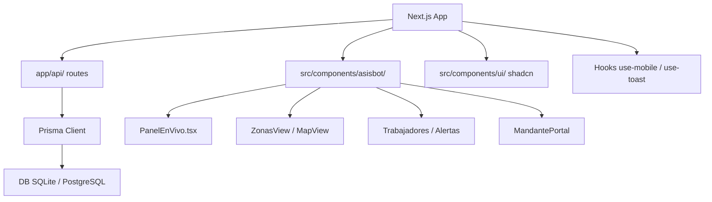

# Diagrama de arquitectura — asisbot22

Componentes clave:
- **App**: Next.js 14 + Tailwind + TypeScript
- **API**: `/api/consent`, `/corrections`, `/checkins`, `/zones`, `/workers`, `/dashboard`, `/reports`, `/alerts`, `/mandante`, `/demo`
- **DB**: Prisma (`prisma/`)
- **UI**: shadcn/radix + componentes asisbot
- **Asisbot**: gestión de asistencia (zonas, jornadas, simulador WhatsApp, mapa, reportes, portal mandante)
